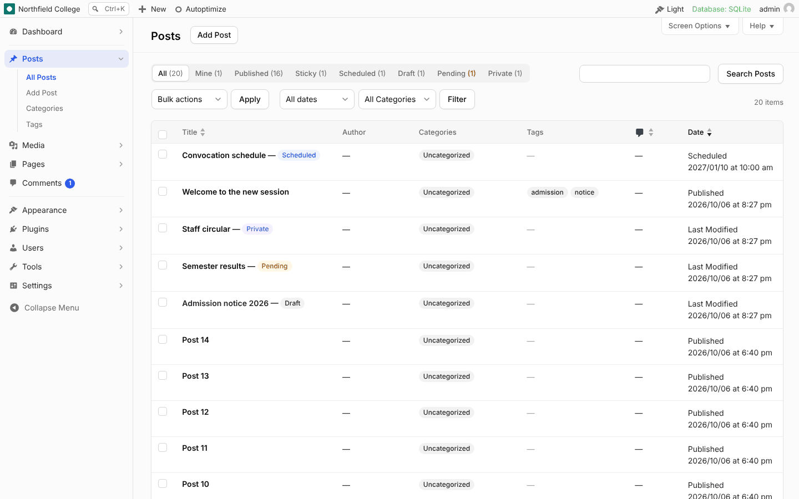
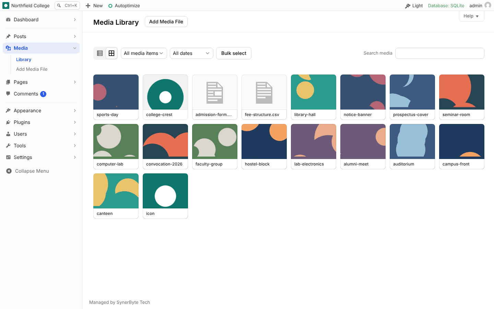
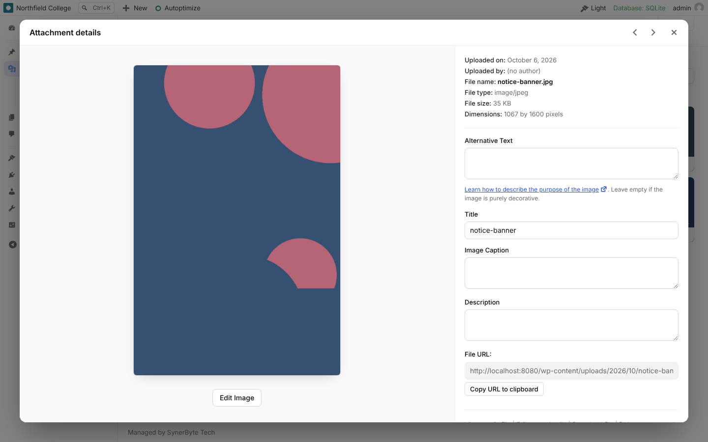
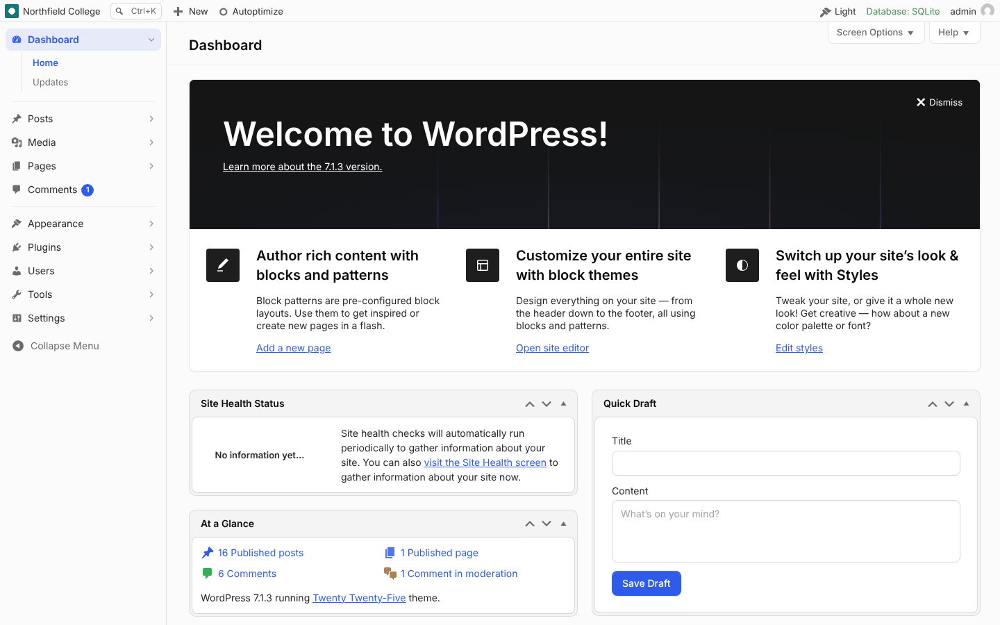
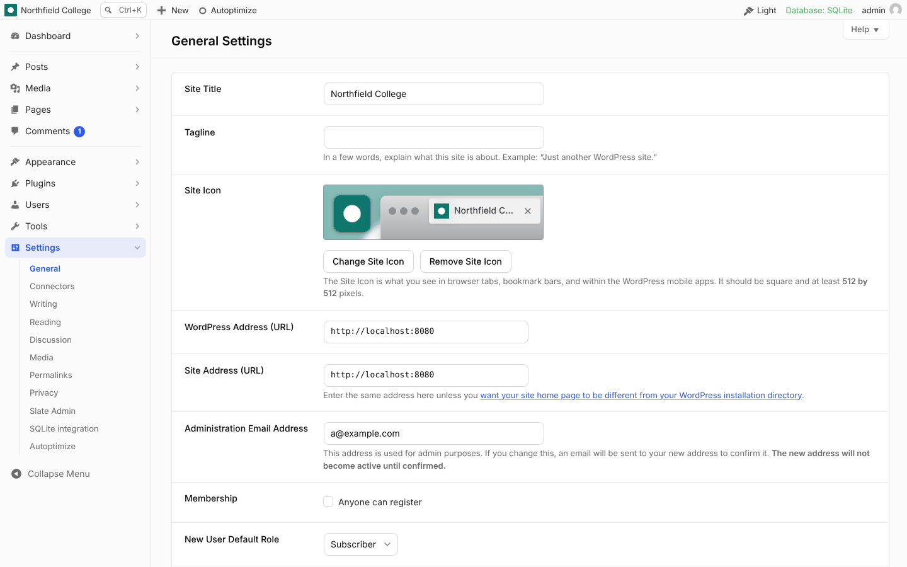
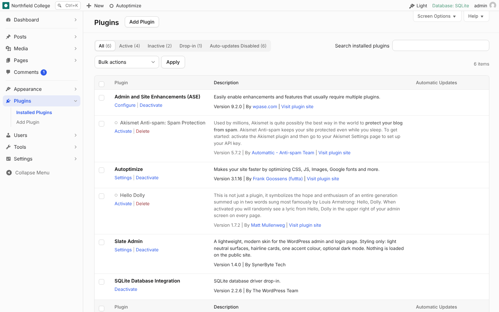
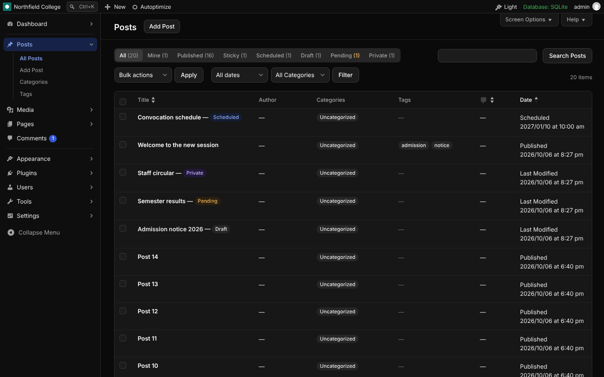
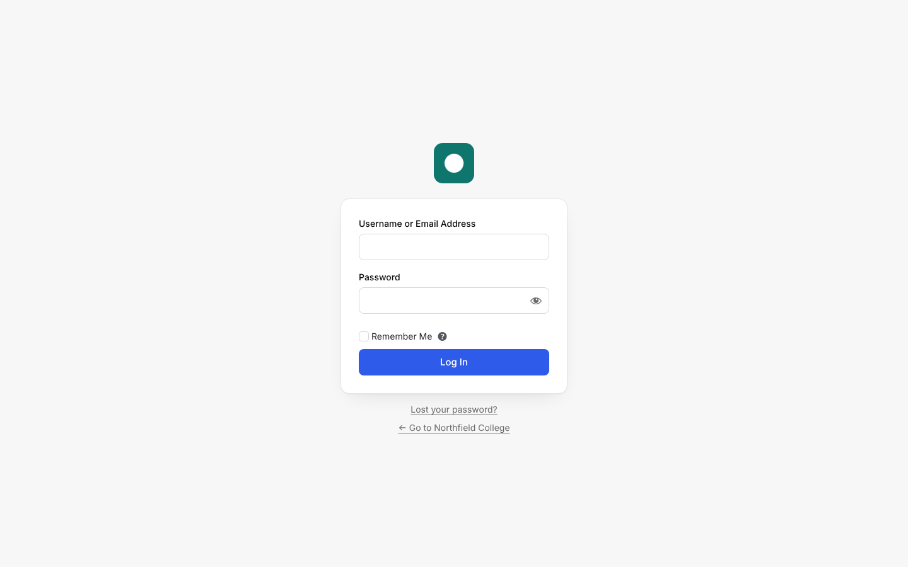

# Slate Admin

A lightweight, modern skin for the WordPress admin and login page. Styling only: it changes how the admin looks and leaves how it works alone.



## Why

Most admin themes ship settings panels, icon packs and JavaScript frameworks. The look itself is almost entirely CSS, so this plugin is a few stylesheets and under 1 KB of script, with nothing loaded on the public site.

## What you get

- **Clean surfaces.** One soft canvas for the page, sidebar and toolbar. White is kept for cards, tables and fields, so content stands out. Faint shadows on raised surfaces.
- **Layered cards.** Dashboard widgets and plugin cards sit on a recessed layer with a white panel inside. Core settings screens are laid out as cards.
- **Sidebar.** Compact rows, a soft accent tint on the open section, chevrons on sections with sub-items, even spacing in fly-out menus.
- **Colour with meaning.** Outlined pills for Draft, Pending, Scheduled and Private. Dots for inactive or outdated plugins. Amber update counts. Published content and active plugins stay plain, so long lists stay calm.
- **List tables.** Status filters as a segmented control, categories and tags as soft chips.
- **Media.** Library grid and list, attachment details, uploader and the "Add media" dialog, including inside the block editor.
- **Login.** Restyled login, lost password and reset screens.
- **Dark mode.** A site default plus a per-user toggle in the toolbar (Light, Dark, System).
- **Block editor.** Picks up the accent colour. The editor canvas is left alone.
- **Wide screens.** Content can be centred and capped at 1440px so tables stay readable on large monitors.
- **Readable accents.** Accent text and button labels are contrast-checked against whatever brand colour you pick.

| Media Library | Attachment details |
| --- | --- |
|  |  |

| Dashboard | Settings |
| --- | --- |
|  |  |

| Plugins | Dark mode |
| --- | --- |
|  |  |



## Install

1. Download [`slate-admin.zip`](../../releases/latest/download/slate-admin.zip) from the latest release.
2. In WordPress, go to **Plugins > Add Plugin > Upload Plugin**, choose the zip, then activate.
3. Open **Settings > Slate Admin**.

Use the zip attached to a release. The "Source code" zip that GitHub generates unpacks to a versioned folder name, which WordPress would treat as a different plugin on each update.

## Updates

Once installed, the plugin updates itself from this repository's releases, like a plugin from wordpress.org:

- A new release shows on the **Plugins** and **Updates** screens within six hours of publishing (straight away after **Dashboard > Updates > Check again**), with the changelog under "View details".
- Automatic installs are off unless you turn them on with the plugin's **Enable auto-updates** link on the **Plugins** screen, the same as any other plugin.
- No token or account is needed. The plugin reads the public GitHub API, and the plugin's `Update URI` header stops WordPress from ever confusing it with a different plugin of the same name on wordpress.org.

To turn update checks off entirely on a site, add `define( 'SLATE_ADMIN_DISABLE_UPDATES', true );` to `wp-config.php`. To update from a fork, use the `slate_admin_update_repo` filter (`'owner/repo'`).

### Publishing a release

Bump the version in `slate-admin.php` (header and `SLATE_ADMIN_VERSION`) and the `Stable tag` in `readme.txt`, add a changelog entry, and push to `main`. The release workflow checks the three versions agree, builds `slate-admin.zip` with minified CSS, tags the commit and publishes the release. Sites pick it up on their next check.

## Settings

| Setting | What it does |
| --- | --- |
| Accent colour | Primary buttons, checkboxes, focus rings and counts. Pick from preset swatches or any colour |
| Sidebar highlight | Mark the current sidebar item in neutral grey (default) or the accent colour |
| Default appearance | Light, Dark, or follow the device. Applies to the login page and to users who have not chosen their own |
| Content width | Centred up to 1440px, or full width |

## Agency defaults

To set the same accent on every client site without opening the settings screen, add this to an mu-plugin:

```php
add_filter( 'slate_admin_defaults', function ( $d ) {
    $d['accent'] = '#0f766e';
    return $d;
} );
```

Anything saved on the settings screen overrides these defaults for that site.

To show your own brand colours as the preset swatches, use `slate_admin_accent_presets` (hex => label):

```php
add_filter( 'slate_admin_accent_presets', function () {
    return array( '#0f766e' => 'Brand teal', '#111827' => 'Ink' );
} );
```

## What it deliberately does not do

Slate Admin only changes appearance. These are left to WordPress or to a utility plugin such as [Admin and Site Enhancements (ASE)](https://wordpress.org/plugins/admin-site-enhancements/), and Slate styles whatever they produce:

| Job | ASE feature |
| --- | --- |
| Removing toolbar items such as the WordPress logo | Clean Up Admin Bar |
| Admin footer text | Custom Admin Footer Text |
| Login logo and its link | Site Identity on Login Page |
| Sidebar width | Wider Admin Menu |

## Compatibility

- WordPress 6.4 or later, PHP 7.4 or later. Tested on WordPress 6.8 and 7.1.
- Tested alongside ASE 9.2 and Autoptimize.
- The skin pins the core colour scheme to the neutral base and hides the per-user colour scheme picker, because the toolbar toggle replaces it.
- Screens from plugins that hardcode light colours (page builders, some shop screens) can look patchy in dark mode. Light is the default for that reason.

## Files

```
slate-admin.php     Plugin bootstrap, settings screen, accent and contrast logic
includes/updater.php  Update checks against this repository's GitHub releases
uninstall.php       Removes the stored option, per-user appearance choice and update cache
assets/admin.css    Admin skin
assets/media.css    Media skin, loaded only on media screens
assets/login.css    Login screens
assets/admin.js     Appearance toggle in the toolbar
.github/            Release workflow and the CSS minifier it uses (not shipped)
readme.txt          WordPress-format readme and changelog
```

## Credits

The design tokens follow the neutral, card-based language of Cloudflare's open source [Kumo](https://github.com/cloudflare/kumo) design system (MIT licensed). No third-party logos, fonts or assets are included.

## Licence

See [LICENSE](LICENSE).

GPL-2.0-or-later, the same as WordPress.
